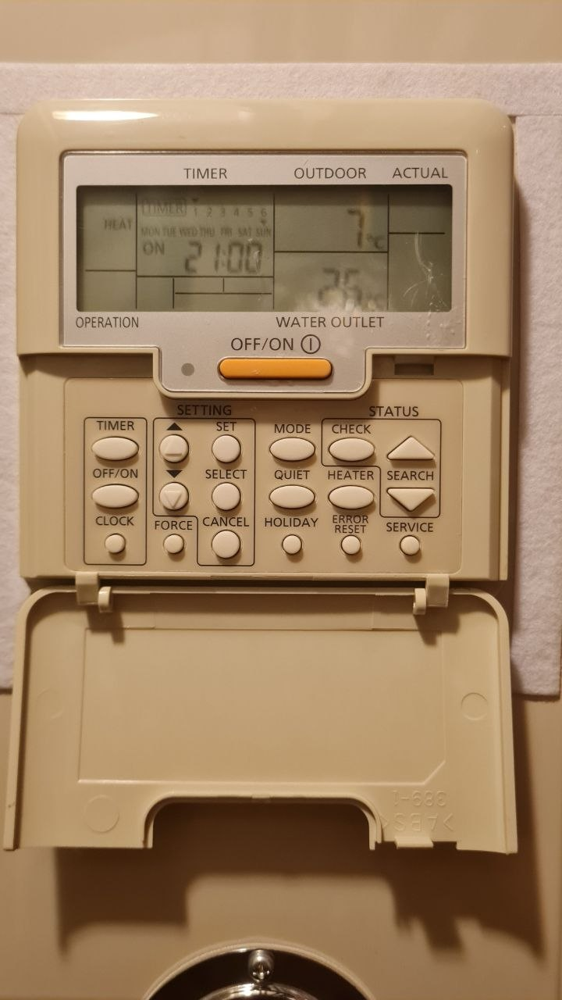
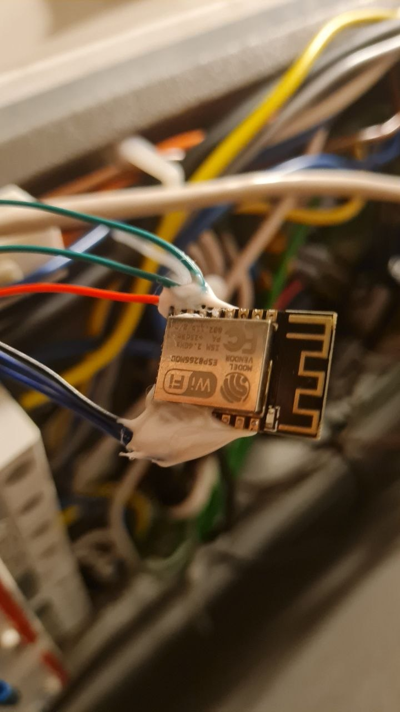
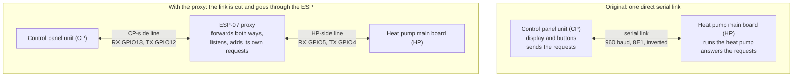
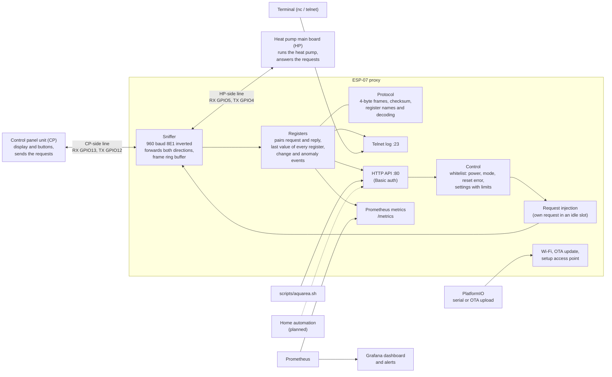
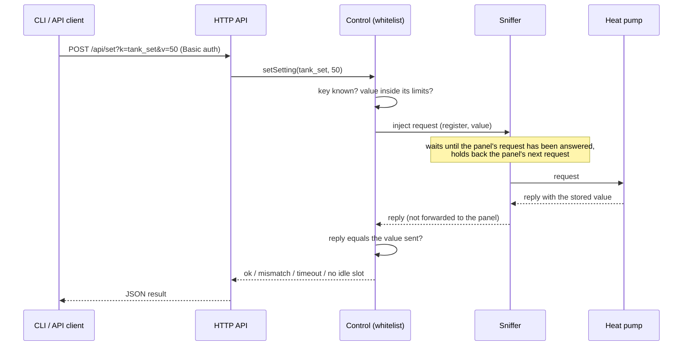

# aquarea

Firmware for an **ESP-07 (ESP8266)** that sits in-line on the serial link between the **control panel
(CP)** and the **heat pump (HP)** of a **Panasonic Aquarea**. It forwards the traffic between the two unchanged, decodes it, and
adds what the original system lacks:

- live view of every register on a telnet log, with changes and anomalies called out
- Prometheus metrics, a Grafana dashboard and alert rules
- an HTTP API and a CLI to read state, switch power and mode, reset errors and change a whitelisted
  set of temperature settings (heating curve, tank and cooling targets)

The panel keeps working as before. If the ESP loses power or crashes, see [Limits](#limits-and-safety).

## Contents

- [Tested with](#tested-with)
- [Architecture](#architecture)
  - [Where the proxy sits](#where-the-proxy-sits)
  - [Components](#components)
  - [How a change reaches the heat pump](#how-a-change-reaches-the-heat-pump)
- [Prerequisites](#prerequisites)
- [Install](#install)
- [Use](#use)
- [Limits and safety](#limits-and-safety)
- [License](#license)

## Tested with

| Part | Model |
|---|---|
| Indoor unit (hydromodule) | Panasonic Aquarea **WH-SXC12F9E8** |
| Outdoor unit | Panasonic Aquarea **WH-UX12FE8** |
| Control panel (the CP side of the link) | built into the indoor unit; spare-part no. CWA75C3689 |

| | |
|---|---|
|  |  |
| The control panel (CP) of this installation. | The ESP module wired into the unit. |

Register meanings and setting limits were observed on this one installation. Other Aquarea models may
use different registers or ranges; check before writing anything to a different unit.

## Architecture

### Where the proxy sits

The proxy is **in the link**, not beside it. The serial line that originally ran straight from the
**control panel unit (CP)** to the **heat pump main board (HP)** is cut in two, and both halves are
wired to the ESP. From then on, the control panel unit and the main board each talk only to the ESP,
which forwards every byte unchanged in both directions.



What this means in practice:

- The control panel unit is the one that asks (frames start with `0xAA`) and the main board answers
  (`0x55`). The proxy keeps that order and only sends a request of its own in an idle moment, after the
  main board has answered the panel.
- While the ESP is powered and running, the panel and the main board do not notice it.
- If the ESP loses power or crashes, **this is the point of interruption**: the panel and the main board
  lose their connection until the ESP is back. See [Limits and safety](#limits-and-safety).

### Components



### How a change reaches the heat pump

The proxy never sends anything on its own schedule. A write waits for a quiet moment on the bus, and the
heat pump's own echo is checked before the call reports success.



Source layout:

| File | Role |
|---|---|
| `src/sniffer.*` | serial lines on both sides, forwarding, frame ring buffer, request injection |
| `src/protocol.*` | 4-byte frame format, checksum, register names, value decoding |
| `src/registers.*` | register table, request/reply pairing, change and anomaly events |
| `src/control.*` | the only way to write: whitelisted commands and settings with limits |
| `src/api.*` | HTTP endpoints (state, read, power, mode, settings, set, reset error, metrics) |
| `src/metrics.*` | Prometheus text rendering |
| `src/telnet_log.*` | telnet log on port 23 |
| `src/main.cpp` | Wi-Fi, setup access point, OTA, main loop |
| `scripts/` | `aquarea.sh` CLI, `pio_secrets.py` build-time secret injection |
| `monitoring/` | Prometheus config, alert rules, Grafana dashboard |

## Prerequisites

Hardware

- ESP-07 module (ESP8266, 1 MB flash) with a 3.3 V supply and a way to connect it to the CP and HP lines.
  Pins: CP receive GPIO13, CP transmit GPIO12, HP receive GPIO5, HP transmit GPIO4 (see `src/sniffer.h`).
  The line is 960 baud, 8E1, inverted; any level adaptation to the connector of that link is up to
  your wiring.
- A USB-to-serial adapter for the first flash (later updates can go over the air).

Software

- [PlatformIO Core](https://docs.platformio.org/en/latest/core/installation/) (needs Python 3). It
  downloads the ESP8266 toolchain on the first build.
- `curl` for the CLI, and `jq` for readable output (optional).
- `nc` or `telnet` to watch the log.
- Optional, for monitoring: Docker with Compose, and a Grafana you can import the dashboard into.
- Optional, for contributors: [`gitleaks`](https://github.com/gitleaks/gitleaks) and
  [`pre-commit`](https://pre-commit.com).

## Install

1. Get the code and create your local secrets file. It is gitignored and must never be committed.

   ```bash
   git clone <repository-url> aquarea && cd aquarea
   cp secrets.env.example secrets.env
   chmod 600 secrets.env
   $EDITOR secrets.env       # DEVICE_PASSWORD (8+ characters) and AQUAREA_HOST
   ```

   `DEVICE_PASSWORD` is compiled into the firmware. It protects OTA upload, the setup access point and
   the HTTP API (user `aquarea`). `AQUAREA_HOST` is the proxy's address, used for OTA upload and by the
   CLI. The build stops if `secrets.env` is missing or still holds the example value.

2. Build.

   ```bash
   pio run                   # builds both environments: esp07 (serial) and esp07_ota
   ```

3. First flash over serial (adapter connected, module in flash mode).

   ```bash
   pio run -e esp07 -t upload
   ```

4. Join your Wi-Fi. Until it has credentials, the proxy opens an access point named `ESP8266_AP`
   (password = `DEVICE_PASSWORD`, address `10.1.1.1`). Connect to it, open `http://10.1.1.1/wifi` (log in as `aquarea` with `DEVICE_PASSWORD`),
   enter your network's name and password, and the module restarts and joins it. Give it a fixed address
   in your router and put that address into `AQUAREA_HOST`.

5. Later updates over the air.

   ```bash
   pio run -e esp07_ota -t upload      # address and password come from secrets.env
   ```

## Use

```bash
scripts/aquarea.sh help            # all commands
scripts/aquarea.sh test            # read-only health checks, safe at any time
scripts/aquarea.sh status          # power, mode, temperatures, errors
scripts/aquarea.sh state           # every register; changeable ones show their "set key"
scripts/aquarea.sh settings        # the changeable settings: value, limits, age
scripts/aquarea.sh set tank_set 50 # change one (asks first; -y skips, -n prints only)
nc <AQUAREA_HOST> 23               # live decoded bus log
```

The CLI reads `AQUAREA_HOST` and `DEVICE_PASSWORD` from `secrets.env`; the environment variables
`AQUAREA_HOST` and `AQUAREA_PASS` override them.

Two details about settings:

- `settings -r` reads them from the heat pump first. It never reads the heat curve shift (register 138),
  because on that register a request with value 0 is a write that resets the shift to 0.
- Only keys in the whitelist can be changed, each within its own limits (`src/control.cpp`). There is
  deliberately no "write any register".

Monitoring (Prometheus, Grafana, alerts): see [monitoring/README.md](monitoring/README.md).

## Limits and safety

- The proxy is in the signal path. A crash or power loss of the ESP interrupts the connection between the
  control panel unit and the heat pump main board until it restarts; a bypass is not part of this design.
- The HTTP API uses Basic auth over plain HTTP, and the telnet log on port 23 has no authentication.
  Keep the proxy on a trusted network segment, and put TLS in front if you expose the API further.
- The `/wifi` setup page asks for the same login as the API (user `aquarea`, `DEVICE_PASSWORD`), but over plain
  HTTP like everything else here, so the Wi-Fi password you enter travels unencrypted on the local network.
- The firmware image contains `DEVICE_PASSWORD`; treat built binaries like secrets.
- Register meanings come from observing a single installation; settings limits are conservative guesses.
  Check them against your unit's manual before widening them.

## License

See [LICENSE](LICENSE).
